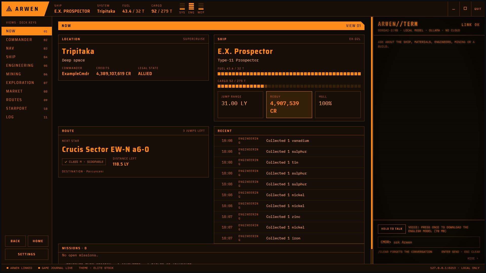

# Arwen

A second-monitor companion for Elite Dangerous on Windows. Arwen reads the game as you play and
keeps what you need in view: where you are and where you're going, your ship and its engineering,
the materials you still need and where to get them, where to mine, what to buy where, your colony
builds and your missions. Ask it questions in plain words, by typing or by voice, and put it on a
Stream Deck if you have one.

Arwen is free, in early access: expect rough edges, and please [report what you find](#help-and-bug-reports).

**[Download the newest version](../../releases/latest)** · [What's new](../../releases)

Not affiliated with or endorsed by Frontier Developments. Elite Dangerous is a trademark of Frontier
Developments plc. See the [disclaimer](DISCLAIMER.md).



More: [Ship](screenshots/ship.png) · [Engineering](screenshots/engineering.png) ·
[Starport](screenshots/starport.png) · [Nav](screenshots/nav.png) · [Market](screenshots/market.png) ·
[Exploration](screenshots/exploration.png) · [Commander](screenshots/commander.png) ·
[Settings](screenshots/settings.png). The screenshots show an example commander.

- [AI chat (optional)](#ai-chat-optional)
- [Install](#install)
- [First start](#first-start)
- [The screen](#the-screen)
- [The views](#the-views)
- [Asking Arwen](#asking-arwen)
- [Stream Deck](#stream-deck)
- [Claude](#claude)
- [Updates](#updates)
- [Settings](#settings)
- [Your data and privacy](#your-data-and-privacy)
- [Troubleshooting](#troubleshooting)
- [Help and bug reports](#help-and-bug-reports)

## AI chat (optional)

**Arwen works without an AI model.** Every view, the Now bar, the Stream Deck's view and live-value
keys, engineering plans and all the searches run on Arwen alone. Only the chat on the right, where you
ask Arwen questions in plain words, needs a language model. Until there is one, the chat input is
off and says why, and the status bar shows **AI CHAT · OLLAMA NOT RUNNING** or
**AI CHAT · MODEL MISSING**.

| Works without a model | Needs a model |
| --- | --- |
| All views: Now, Commander, Nav, Ship, Engineering, Mining, Exploration, Market, Routes, Starport, Log | Asking questions in the chat |
| Engineering plans, saved blueprints and the steps to get there | Push-to-talk (HOLD TO TALK, the deck's TALK key): your words go to the chat |
| Market, material, mining and station searches | Stream Deck keys that ask Arwen a question of your own |
| Saved routes and lists, made by hand | Asking Arwen to save a route or list for you |
| Stream Deck keys for views, Back, Home and live values | |
| Open in Coriolis, updates, themes | |
| Claude Code and Claude Desktop over MCP (they bring their own model, see [below](#using-claude-desktop-instead)) | |

### Requirements

- **[Ollama](https://ollama.com)**, free, which runs the model on your PC (or another PC on your
  network). Nothing you ask leaves your network. No room for a model on your PC? A cloud model works
  too, with your own API key: see [Using OpenRouter instead](#using-openrouter-instead) (one key for
  many models, a fraction of a cent per question), or pick OpenAI-compatible or Anthropic in
  Settings, AGENT MODEL.
- **A model that can call tools.** Arwen answers by calling its tools (your ship, your materials, the
  market) and the model only puts the results into words, so a model without tool calling can't
  answer. The default is `bonsai-2:9b`. Other models with tool calling work too, for example
  `qwen3:4b`.
- **Room on your graphics card.** Elite Dangerous: Odyssey uses most of an 8 GB card on its own,
  and the model needs video memory of its own. Go by what `ollama ps` shows rather than by the
  model's name: the default `bonsai-2:9b` is a compressed 9B model and takes about 3 GB with Arwen's
  settings (8K context). If the model doesn't fit, Ollama puts part of it in main memory and answers
  get slow. On an 8 GB card, try one or more of these:
  - cap the game at 60 fps and lower its texture quality;
  - use a small model such as `qwen3:4b`, and untick **Let the model think before it answers** in
    Settings, AGENT MODEL (thinking makes answers about twice as slow);
  - run the model on the processor instead (much slower, but it leaves the graphics card to the
    game): set the Windows environment variable `CUDA_VISIBLE_DEVICES` to `-1` (NVIDIA) or
    `HIP_VISIBLE_DEVICES` to `-1` (AMD), then quit Ollama from its tray icon and start it again.

### Setup on Windows

1. Download Ollama from [ollama.com/download](https://ollama.com/download) and install it. It runs in
   the background (an icon in the tray) and starts with Windows.
2. Open PowerShell or Command Prompt and get a model:

   ```
   ollama pull bonsai-2:9b
   ```

   or another model with tool calling, such as `ollama pull qwen3:4b`.
3. Check the name it was installed under:

   ```
   ollama list
   ```

4. In Arwen, open **Settings, AGENT MODEL**: **PROVIDER** "Ollama on this PC", **MODEL** the name
   exactly as `ollama list` shows it, **OLLAMA ADDRESS** `http://127.0.0.1:11434` (the default).
   Press **USE THIS MODEL**.
5. The status bar now says **AI CHAT CONNECTED** and the chat header **LINK OK**. Ask something,
   for example "where am I?".

### Does it fit next to the game?

Start Elite Dangerous, ask Arwen a question, then run:

```
ollama ps
```

The PROCESSOR column says where the model runs. `100% GPU` is what you want. Something like
`45%/55% CPU/GPU` means it didn't fit on the graphics card and part of it runs on the processor:
answers will be slow, and the game may stutter. Use the tips under [Requirements](#requirements).

### Using OpenRouter instead

[OpenRouter](https://openrouter.ai) runs models for you online, so you need no Ollama and no room on
your graphics card. One account and one key give you models from many companies, and you pay
OpenRouter for what you use. The catch: your questions, and the game data Arwen's tools return for
them (your location, ship, materials), go to OpenRouter and the company whose model you picked.

1. Make an account at [openrouter.ai](https://openrouter.ai), add a few dollars of credit, and create
   an API key under **Keys**. Copy it; OpenRouter shows it only once.
2. In Arwen, open **Settings, AGENT MODEL**: **PROVIDER** "OpenRouter (cloud, many models)", **MODEL**
   the model's name as OpenRouter writes it (see below), **API KEY** the key you copied. Press
   **USE THIS MODEL**. The key goes to Windows Credential Manager, never to a file.
3. Ask something, for example "where am I?". The status bar says **AI CHAT CONNECTED** as soon as a
   key is saved, so the first answer is the real test.

The model has to support tool calling. These answered correctly in testing, with a few cents of
credit lasting a long time:

| Model | Answers | Notes |
| --- | --- | --- |
| `openai/gpt-oss-120b` | in a few seconds | the cheapest; a good first choice |
| `qwen/qwen3.5-9b` | in a few seconds | the same family as the local default |
| `openai/gpt-5-mini` | in 10 to 30 seconds | thinks first; the most careful answers |

A set of test questions across these three cost about one cent in total. Models whose names end in
`:free` cost nothing, but OpenRouter limits them to a few questions a minute, and the chat then
says to wait. On [openrouter.ai/models](https://openrouter.ai/models), filter by **Tools** to see
which models can use Arwen's tools, and their prices.

The **Let the model think before it answers** setting only applies to Ollama; a cloud model thinks or
not as it was built to.

### Using Claude Desktop instead

If you use Claude Desktop, it can use Arwen's tools with its own model, and you don't need Ollama
at all:

1. Install Arwen with **Let Claude use Arwen's tools** ticked (or run the installer again and tick
   it), and in Arwen turn on **Settings, CLAUDE · MCP, LET CLAUDE USE ARWEN'S TOOLS**.
2. Press **COPY DESKTOP CONFIG** there, or write the entry yourself. In Claude Desktop open
   Settings, Developer, **Edit Config**, and add Arwen under `mcpServers`:

   ```json
   {
     "mcpServers": {
       "arwen": {
         "command": "C:\\Users\\<your Windows user>\\AppData\\Local\\Programs\\Arwen\\Arwen.McpBridge.exe",
         "args": []
       }
     }
   }
   ```

   That is where the installer puts Arwen. The entry holds no key: the bridge gets it from Windows
   Credential Manager.
3. Restart Claude Desktop. Arwen has to be running while you use it.

Claude Code works the same way: **COPY COMMAND** in the same panel gives the one command to run. See
[Claude](#claude).

## Install

1. Download `Arwen-Setup-<version>-win-x64.exe` from the [newest release](../../releases/latest).
2. Run it. Windows may warn that the publisher is unknown, because the installer isn't signed yet:
   choose **More info**, then **Run anyway**. Arwen installs for your Windows user only, without
   administrator rights.
3. Pick your options:
   - **Stream Deck plugin**, offered when Stream Deck is installed.
   - **Desktop shortcut**, off by default.
   - **Let Claude use Arwen's tools**, off by default (see [Claude](#claude)).
4. Start Arwen from the Start menu and put its window on your second monitor. It remembers where
   you left it.

You need Windows 10 or 11 (64-bit) and Elite Dangerous on PC: Steam, Epic or Frontier all work.
Arwen's window needs the Microsoft Edge WebView2 Runtime, which Windows 11 and an up-to-date
Windows 10 already have; the installer tells you if it's missing.

To check the download, compare it with `SHA256SUMS.txt` from the same release:
`Get-FileHash .\Arwen-Setup-<version>-win-x64.exe` in PowerShell.

## First start

Arwen finds the game's journal folder by itself and catches up on what you've done. Start the game
and Arwen follows along. Three things are worth setting in **Settings** early:

- **HOME:** your home system. Engineers, market searches and mining spots are planned from there,
  and the Now bar shows how far you are from it. Type a system or use the one you're in.
- **AGENT MODEL:** the model that answers your questions in the chat (see
  [AI chat (optional)](#ai-chat-optional)). Everything else works without one. The first time, the
  chat shows a short note about this; **DON'T SHOW AGAIN** hides it for good.
- **GAME JOURNAL:** only if Arwen says it can't find your journals, for example when the game
  writes them somewhere unusual.

## The screen

- **The Now bar** along the top: your ship, system, station, distance home, fuel, cargo, pips,
  current colony build, mining session and next engineering step. Choose which ones show in
  Settings, NOW BAR.
- **The rail** on the left: one button per view, with Back, Home and Settings. Back (also Alt+Left
  or your mouse's back button) returns to the previous view as you left it; Home goes to your home
  view.
- **The chat** on the right: ask Arwen anything about your game. Hide it when you only want the
  views.
- **The status bar** along the bottom: whether the game, the model and the online services are
  reachable.

Views keep their filters and scroll position when you switch away and back.

## The views

### Now

Where you are, your ship, fuel and cargo, your current route, your open missions (where to go, time left and reward, soonest
to expire first), and the last few things that happened.

### Commander

Your ranks and progress in each, navy ranks, Pilots' Federation, your powerplay power, rank and
merits, your reputation with the superpowers, your squadron, and your statistics.

### Nav

The system you're in, its bodies and stations, and your plotted route leg by leg: the next star,
jumps and distance left. A star you can't scoop fuel from is marked, so you know before you jump.

### Ship

Your ship's loadout and engineering, its power use, and every ship you own with where it's stored.
Arwen remembers your stored ships between sessions; you don't need to open a shipyard first.

**Open in Coriolis** shows the ship's build, with all its engineering, in [Coriolis](https://coriolis.io) in
your browser. **Copy for Coriolis** copies it instead: in Coriolis, choose Import and paste. It works for any ship
you've flown since your journals began.

### Engineering

Ship and on-foot engineering, from unlocking engineers to the last roll.

- **Ship engineers:** each engineer, whether you've unlocked them, your grade with them, where they
  are and what unlocks them next. Click an engineer to see more.
- **Saved blueprints:** pick the blueprints and grades you want for a ship. Arwen shows what you can
  roll now, and **all materials together**: what your blueprints need, what you hold and what's
  short. A blueprint belongs to a kind of module, not to one mount: if you engineer it on another,
  identical module (say the third shield booster instead of the first), it still counts as done.
  Modules are shown by their names in game, such as "A Shield Booster", and a blueprint whose module
  is no longer fitted says NOT FITTED.
- **The plan:** numbered steps to get there: which engineers to unlock, materials to trade or
  gather, and which engineer to visit for what. It picks the engineers nearest your home, so it
  won't send you to Colonia from the bubble. Progress ticks off as you play.
- **Trades:** the plan pays for what you're short with what the plan doesn't need, at the cheapest
  rate: one spare material a grade up (1 for 3) before six a grade down, and a stock near its cap
  before a small one. It also trades between columns of the trader (6 for 1 at the same grade,
  2 for 1 a grade down), but then always leaves a quarter of the cap in your hold (25 of a G5,
  37 of a G4) and never trades up a grade, which would cost 36 for 1.
- **Tech broker:** pin the broker unlocks you want and see what they still need.
- **On foot:** your suits and weapons, with their grade and modification slots (one per grade above
  1, four at G5). Track the grades and modifications you want, and Arwen lists the materials for
  them all together and makes a plan: grades to raise at Pioneer Supplies first, then each
  engineer to unlock in the right order, with how far you are with each invitation, and what to
  apply where. If the game asks for a different amount than Arwen shows, you can correct it.

### Mining

Where to mine, for powerplay merits (reinforce, acquire or undermine) or for profit. Each ring is
paired with a place to sell, and Arwen says whether the sale counts for merits and why. Save one as
a route. **This session** counts tonnes refined and merits earned while you mine.

### Exploration

The system you're in: how much of it you've scanned, each body's scan and mapping, first discovery
and footfall, and what it's worth, with the bodies worth mapping marked. Your unsold exploration
data (lost if you die), exobiology samples on the body you're on, and the systems you've explored.

### Market

- **Buy near me:** where to buy a commodity near you or your home, by pad size and distance.
- **Nearest station with:** a material trader (of any type), technology broker, interstellar
  factors, Universal Cartographics, black market, shipyard, outfitting, repair and more.
- **Where to get a material:** the nearest trader or other source for it.

Any system name can be copied for the galaxy map with one click.

### Routes

Routes you save, from Mining, Engineering or by hand, with stops that tick off as you arrive, and
lists for anything else: shopping lists, bookmarks, notes and checklists.

### Starport

Your colony construction sites: what each still needs, what's delivered, what's in your hold and
how many runs are left. **Supply run** finds where to buy what's missing. **Set as current build**
pins one site to the Now bar and the Stream Deck.

### Log

What happened this session, event by event, and a log of every change made to your plans by you,
the agent or Claude.

## Asking Arwen

Type in the chat, or hold **HOLD TO TALK** (or TALK on the Stream Deck) and speak. Arwen answers
from your game and can open the view that shows the answer. For example:

- "How many merits do I need for rank 34?"
- "Where's the nearest raw material trader?"
- "What do I still need for my FSD blueprint?"
- "Which of my ships can carry 400 tonnes?"
- "Where should I mine Platinum for merits?"

The answers come from a language model you choose in Settings, AGENT MODEL. The chat is optional
and needs that model; [AI chat (optional)](#ai-chat-optional) has the setup.

- **Local (recommended):** [Ollama](https://ollama.com) and a model, e.g. `ollama pull bonsai-2:9b`.
  It runs on your PC, or another PC on your network; nothing leaves your network.
- **Cloud:** [OpenRouter](#using-openrouter-instead), another OpenAI-compatible service, or
  Anthropic, with your own API key. Your question and the game data it needs then go to that service.

Voice input runs on your PC's processor, in English. The speech model (about 70 MB) downloads the
first time you use it. The microphone is only open while you hold the key, and nothing is recorded.
Pick the microphone in Settings, VOICE. Arwen doesn't speak its answers yet.

A wrong answer? Press **FLAG** on it; it helps us fix it.

## Stream Deck

With the plugin installed, drag the **Arwen key** onto your keys; each key sets itself up from its
position, and you can change what it does in its settings. Pair the deck once in Arwen's Settings,
STREAM DECK: type the six-digit code into any key's settings.

Keys can open a view, go Back or Home, show live values (fuel, free cargo space, what your colony
build still needs, the next jump with a warning for stars you can't scoop, mining merits), show
your next engineering step, ask Arwen a question of your own, or push-to-talk. The keys follow
Arwen's colours.

## Claude

If you use Claude, it can read your game through Arwen and change your plans, lists and routes,
for example "plan the engineering for my ship". It's off unless you ticked it in the installer;
turn it on in Settings, CLAUDE · MCP, which also has the one-time setup for Claude Code and Claude
Desktop ([step by step](#using-claude-desktop-instead)). Claude uses its own model, so this works
without Ollama. Changes Claude makes show in the Log view.

## Updates

Arwen checks for a newer version shortly after it starts and asks first: **Update now**, **Later**
or **Skip this version**. Updating downloads the installer, checks it against its published
checksum, closes Arwen, installs with the choices you made before, and starts Arwen again. Your
data stays.

Settings, UPDATES shows your version, has **Check for updates**, and turns the check at start off.
The check asks GitHub for the newest release and sends nothing else.

## Settings

- **Theme:** the HUD colour (presets or your own), the chat terminal's colour, and CRT effects.
- **Game journal**, **Home**, **Now bar**: see above.
- **Startup:** the boot animation and its sound.
- **Agent model**, **Voice**, **Stream Deck**, **Claude · MCP**, **Updates**: see above.

## Your data and privacy

Arwen only reads the files Elite Dangerous writes to your Saved Games folder. It never changes them
and never presses keys in the game.

Everything Arwen keeps stays on your PC, in `%LOCALAPPDATA%\Arwen`: your settings, saved blueprints,
plans, lists and routes, the chat log (kept 30 days; Settings turns it off) and error logs. API keys
and the Stream Deck pairing go to Windows Credential Manager, never to a file.

Arwen goes online only for:

- searches: Spansh, Ardent and EDSM get the system and item you search for;
- a cloud agent model, if you choose one;
- the update check and the voice model download, from GitHub and Hugging Face.

To uninstall: Windows Settings, Apps, **Arwen**, Uninstall. Your data stays in
`%LOCALAPPDATA%\Arwen`, so a reinstall keeps your plans; delete that folder to remove it too.

## Troubleshooting

### The chat says "error 10061" or "127.0.0.1:11434"

The message may be in your Windows display language (in Spanish, for example, it reads "No se puede
establecer una conexión ya que el equipo de destino denegó expresamente dicha conexión"). Error
10061 means nothing answered at the AI model's address: the chat couldn't reach Ollama. Newer
versions of Arwen say "Can't reach the AI model at http://127.0.0.1:11434" instead. The rest of
Arwen is unaffected.

| Cause | Fix |
| --- | --- |
| Ollama isn't installed | Follow [Setup on Windows](#setup-on-windows), or use the views without the chat. |
| Ollama isn't running | Start **Ollama** from the Start menu (its icon appears in the tray). Check with `ollama list` in PowerShell: it should list your models, not an error. |
| Wrong address | In Settings, AGENT MODEL, **OLLAMA ADDRESS** must be where Ollama listens: `http://127.0.0.1:11434` on this PC. In a browser that address shows "Ollama is running". For Ollama on another PC, use that PC's address and let Ollama listen on the network there (`OLLAMA_HOST` set to `0.0.0.0`, and port 11434 open in its firewall). |

### The chat says the model isn't installed

Ollama is running but doesn't have the model named in Settings, AGENT MODEL, **MODEL**. Install it
with `ollama pull <model>`, using the name shown in the message, or change **MODEL** to one that
`ollama list` shows.

### The chat says the model can't use tools

Arwen's answers come from its tools, so the model has to support tool calling. Pick one that does,
such as `bonsai-2:9b` or `qwen3:4b`.

### The chat says the API key was turned down, there's no credit, or to wait

These come from a cloud model's service (OpenRouter, for example), and the message includes what the
service said.

| Message | Fix |
| --- | --- |
| "turned the API key down" | Paste the key again in Settings, AGENT MODEL, **API KEY**, or make a new one at the service. A key that was deleted or copied with a missing character gives this. |
| "has no credit left" | Add credit at the service, or pick a model that is free there (on OpenRouter, names ending in `:free`). |
| "is limiting requests for now" | Wait a minute and ask again. Free models have tight limits; a paid one doesn't hit this in normal use. |
| "doesn't know the model" | Check **MODEL** in Settings: it must be written exactly as the service names it, such as `openai/gpt-oss-120b`. |
| "can't use tools" | Pick a model with tool calling ([Using OpenRouter instead](#using-openrouter-instead) has some). |

### Answers are very slow

The model probably doesn't fit on the graphics card next to the game: see
[Does it fit next to the game?](#does-it-fit-next-to-the-game).

## Help and bug reports

[Open an issue](../../issues) and say what you did, what you expected and what happened. Please
attach `%LOCALAPPDATA%\Arwen\logs\arwen.log`. For a wrong answer from the agent, the chat log in
`%LOCALAPPDATA%\Arwen\logs\chat` helps too.

## AI disclaimer

AI has been used in the design phase of Arwen: to plan the architecture, and to write code comments
and release notes.

## Licence

Arwen is free to download and use, but not open source: see [LICENSE](LICENSE). Please share the
[releases page](../../releases) rather than the installer. Arwen includes other people's work under
their own licences: see [THIRD-PARTY-NOTICES.md](THIRD-PARTY-NOTICES.md).
